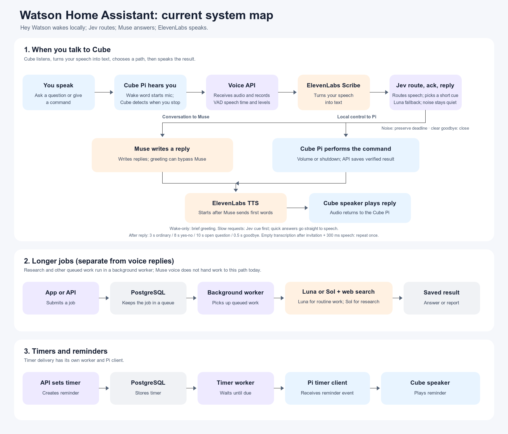

# Watson Home Assistant current system map

## Voice path

1. The Pi detects “Hey Watson” with the bundled local ONNX wake-word model and opens a voice session.
2. Local speech activity detection finds a turn. The Pi sends the captured audio to the voice API.
3. ElevenLabs Scribe transcribes the turn. Jev uses the transcript and recent context to decide whether Watson was addressed, which route to use, and whether a short acknowledgment fits. Luna Decisions is the fallback.
4. Ordinary conversation goes to Muse. Supported volume and shutdown requests use the Pi's verified device-action path.
5. ElevenLabs streams the answer as speech. The Pi waits for playback to drain, then opens the follow-up window selected for the answer.

Playback and listening are half-duplex to reduce the chance of the Pi hearing its own speech. If Scribe returns no words, the recovery behavior depends on turn length and conversation state; empty noise turns stay quiet.

## Other paths

- **Longer jobs:** the API stores work in PostgreSQL. A separate worker handles research and planning jobs and saves the result.
- **Timers:** a timer worker waits for due reminders, then sends a device event for spoken delivery.
- **Observability:** Langfuse traces speech recognition, Jev routing and fallback, Muse response generation, speech output, and session completion.

See the [hardware runbook](hardware-runbook.md), [conversation experience plan](conversation-experience-plan.md), and [voice simulation guide](voice-simulation.md) for setup and behavior details.
