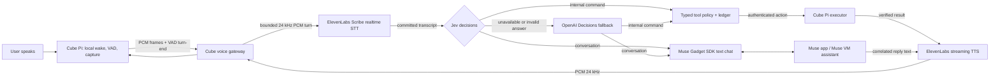

# Watson Home Assistant V2: Muse Gadget SDK + ElevenLabs

Status: parallel Muse + ElevenLabs voice path implemented · 15 October 2026

## Goal

Build a second voice path while Cube V1 remains available. Run Muse Gadget SDK as a paired Linux gadget beside the Cube API. Keep Cube Pi as the only microphone/speaker owner. Use ElevenLabs Scribe for speech recognition and ElevenLabs TTS for reply speech. Jev routes each transcript using the previous accepted exchange as context, with OpenAI Decisions (`gpt-6-luna`) as fallback if Jev fails or returns an invalid answer; Muse receives ordinary conversation text and owns those replies. Keep V1 selectable as rollback.

This plan refers to [Meta’s Muse Gadget SDK](https://github.com/facebookincubator/muse-gadget-sdk), not Muse Voice Transcribe. SDK turns Raspberry Pi/Linux or ESP32 into a gadget paired to Muse app. Linux client maintains connection to Muse VM, receives `link.invoke` commands, can post text or WAV voice notes, and can subscribe to Muse chat events. Its WAV path is turn-based upload, not a live streaming ASR socket. [SDK overview](https://github.com/facebookincubator/muse-gadget-sdk#readme) · [Linux client API](https://github.com/facebookincubator/muse-gadget-sdk/blob/main/linux/src/musegadget/link_client.py) · [Turn tracking](https://github.com/facebookincubator/muse-gadget-sdk/blob/main/linux/src/musegadget/muse_turn.py)

## Recommended shape

Muse Gadget SDK handles pairing, transport, Muse chat, and Muse-native assistant behavior. The API host runs as the paired Linux gadget; Cube Pi keeps sole ownership of microphone, wake word, and speaker. At VAD turn end, the provider sends PCM chunks through ElevenLabs' manually committed realtime STT WebSocket. Jev routes supported device commands into the existing typed policy/action-ledger bridge; OpenAI Decisions takes over when Jev is unavailable or returns an invalid answer. All other transcript text goes to Muse `send_chat`. Both reply paths stream text into ElevenLabs TTS and return bounded PCM frames through existing playback. SDK registration advertises no host commands.

Start with one dedicated Muse side chat for Cube conversation state. Subscribe before sending a turn. Correlate assistant events to the acknowledged user message and session; do not speak stale or unrelated chat events. SDK already includes `MuseTurn` tracking for reply ordering and completion; adapt it rather than treating the `/chat/stream` acknowledgement as the reply. SDK README says post returns acknowledgement while reply appears in Muse chat. [Linux SDK README](https://github.com/facebookincubator/muse-gadget-sdk/blob/main/linux/README.md)

V1 remains selectable. Develop and replay V2 beside V1. The server selector chooses provider per deployment; Pi microphone capture stays on one device process.

## Build stages

Implemented: VAD turn-end contract, bounded PCM provider, ElevenLabs realtime STT and 24 kHz streaming TTS, SDK `MuseTurn` reply correlation and HTTP-ack normalization, durable Muse chat/replay state, Context-aware Jev routing with OpenAI Decisions fallback and a second structured action-extraction decision for supported local controls, measured read/relative/set volume tools over the authenticated device bridge, `CUBE_VOICE_STACK=v1|muse`, and no-command SDK registration. See the [current system map](current-system-map.md) and [`deploy/`](../deploy/). Hardware pairing and live account acceptance remain deployment steps.

### M0 — Feasibility and account constraints

- Pin a reviewed SDK commit; inspect Linux installer and config before installing.
- Confirm SDK token availability, Muse app pairing, terms, and the account’s personal/non-commercial fit.
- Run one short speech round trip: Pi PCM → ElevenLabs transcript → Muse assistant → correlated streamed text event.
- Prove one reply can feed ElevenLabs and play from Pi HAT. Measure total speech-end-to-first-audio time.
- Keep the first spike outside production services. No tool calls or wide Pi access.

**Exit:** round trip works with one conversation ID and response correlation; cost and latency recorded.

### M1 — Isolated V2 bridge

- Add a separate `MuseAssistantBridge` around the SDK session, `send_chat`, chat subscription, and `MuseTurn` correlation.
- Send committed ElevenLabs transcript text to Muse with `output_modality="text"`; consume only assistant reply text. Test whether Muse emits usable incremental text before task completion.
- Add ElevenLabs realtime STT with manual VAD-end commit and PCM24k chunks.
- Add `ElevenLabsSpeechOutput` using streaming WebSocket TTS and `eleven_flash_v2_5`; request PCM 24 kHz to match Cube playback. Stream only text deltas belonging to active assistant reply. Flush at turn end; cancel synthesis and playback when turn is abandoned.
- Keep V1 GPT-Live provider unchanged. Add explicit `CUBE_VOICE_STACK=v1|muse` selector to API configuration.

**Exit:** ordinary speech yields one Muse answer; internal speech dispatches one verified tool or asks for clarification; both return one ElevenLabs spoken response.

### M2 — Keep tools outside the Muse SDK

- Keep the gadget command set empty and deny all command calls. This removes shell and file access from the paired SDK device.
- Route supported Cube volume and shutdown requests through Jev, with OpenAI Decisions fallback, and the separate, narrow device policy bridge. Keep owner/device scope, action idempotency, and measured verification.
- Route all ordinary conversation to Muse; never let Muse SDK issue local commands.

### M3 — Voice behavior and resilience

- First ship half-duplex turn-taking: finish recording before sending the audio turn to ElevenLabs; speak reply after Muse produces text. Keep existing local wake-word path.
- Then add barge-in only after acoustic echo cancellation and speaker-to-microphone testing. On confirmed interruption, stop ElevenLabs stream, flush stale playback frames, and start a new turn.
- Bound PCM duration/size, reply text, event buffers, retries, and per-session time. Handle SDK reconnect, expired pairing, TypeSafe, OpenAI Decisions, and ElevenLabs rate limits, empty replies, and provider outages.
- Add stage timings, request/turn/message IDs, provider/model IDs, error codes, and usage counters. Never log audio, transcript body, access tokens, or private response text by default.

**Exit:** repeated turns, interruption, idle close, Pi reboot, lost network, and provider failure recover cleanly.

### M4 — Matched comparison and rollout gate

Compare V1 and V2 on same voice tasks and acoustic conditions:

- Recognition and answer correctness, including names, dates, and times.
- Speech end → first Muse reply text; speech end → first audible TTS; full answer latency p50/p95.
- Jev route/tool correctness and Luna fallback behavior, verified volume readback, interruption stop time, reconnect recovery, and cost per conversation.
- Subjective voice quality and pronunciation.

Set numeric thresholds after M0 baseline. Promote V2 only when recognition, answer quality, and reliability meet target, latency/quality improve enough to matter, and account terms/cost fit intended use. Keep rollback to V1 one config change away.

## Security and product constraints

- SDK default command set can run shell and read/write files as its configured account. This build advertises no commands and rejects all command calls. Use a dedicated non-sudo account. [Linux SDK README](https://github.com/facebookincubator/muse-gadget-sdk/blob/main/linux/README.md)
- Meta states SDK is unsupported and may change or stop without notice. Pin commit; retain V1 fallback. [SDK token terms](https://gadgets.muse.ai/sdk-terms)
- SDK token terms currently permit personal, non-commercial use; restrict use to owner’s Muse account/data; prohibit using token for a paid/promotional device; Meta may suspend or withdraw access. Recheck terms before use and before any broader rollout. [SDK token terms](https://gadgets.muse.ai/sdk-terms)
- SDK source is Apache 2.0, but token terms separately govern Muse service access. [SDK license and terms](https://github.com/facebookincubator/muse-gadget-sdk#license)

## Likely code boundaries

- Keep current Cube capture/playback and session lifecycle: `device/audio_runtime.py`, `device/voice_runtime.py`, `device/voice_relay.py`.
- Add isolated Muse bridge beside current provider composition; do not route Muse traffic through GPT-Live relay.
- Muse turns bypass Cube worker, timer, Home Assistant, policy, and action code under `service/` and `voice/`; Luna-routed device commands use the existing policy/action bridge.
- Keep ElevenLabs key and Muse SDK token server-side/root-owned; device process receives neither.
- Existing SDK can post device-originated chat and subscribe to response events. Plan adapter against pinned SDK API; avoid a second independent implementation of its pairing/Noise transport.

## References

- [Muse Gadget SDK overview](https://github.com/facebookincubator/muse-gadget-sdk)
- [Linux Device SDK README](https://github.com/facebookincubator/muse-gadget-sdk/blob/main/linux/README.md)
- [Linux SDK coding and architecture notes](https://github.com/facebookincubator/muse-gadget-sdk/blob/main/linux/AGENTS.md)
- [SDK device-originated chat, voice-note, chat-subscribe, and TTS APIs](https://github.com/facebookincubator/muse-gadget-sdk/blob/main/linux/src/musegadget/link_client.py)
- [SDK assistant-turn correlation](https://github.com/facebookincubator/muse-gadget-sdk/blob/main/linux/src/musegadget/muse_turn.py)
- [Muse Gadget SDK token terms](https://gadgets.muse.ai/sdk-terms)
- [ElevenLabs Flash model and latency](https://elevenlabs.io/docs/overview/models)
- [ElevenLabs realtime TTS WebSocket](https://elevenlabs.io/docs/eleven-api/guides/how-to/websockets/realtime-tts)
